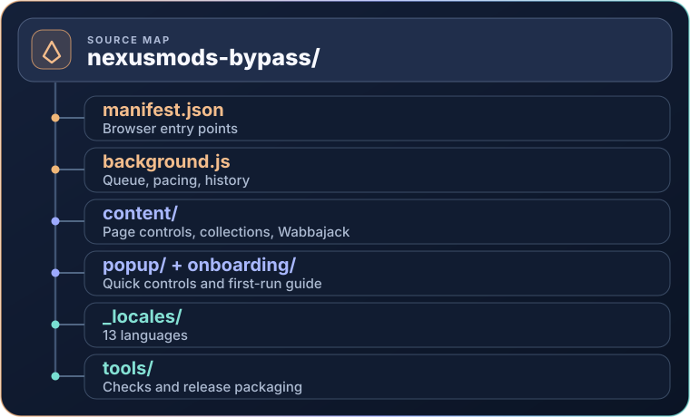

<p align="center">
  
</p>

<p align="center">
  <a href="https://github.com/thomasthanos/nexusmods-bypass/releases/latest"></a>
  <a href="https://github.com/thomasthanos/nexusmods-bypass/releases"></a>
  <a href="https://github.com/thomasthanos/nexusmods-bypass/actions/workflows/release-gate.yml"></a>
  
  <a href="LICENSE"></a>
</p>

<p align="center">
  <a href="https://github.com/thomasthanos/nexusmods-bypass/releases/latest"></a>
</p>

<p align="center">
  <a href="https://chromewebstore.google.com/detail/nexusmods-bypass/chfghiknjhpcncpcjopglefnckckdlpj"></a>
  <a href="https://addons.mozilla.org/en-US/firefox/addon/nexusmods-bypass/"></a>
  <a href="https://microsoftedge.microsoft.com/addons/detail/hcjpcnajmkanhodhpkoinodjbkeolgaa"></a>
</p>

<p align="center">
  <a href="CHANGELOG.md"></a>
  <a href="PRIVACY.md"></a>
  <a href="#bugs"></a>
  <a href="CONTRIBUTING.md"></a>
  <a href="LICENSE"></a>
</p>


<p align="center">Queue a Nexus Mods collection, choose <b>Vortex</b> or <b>browser download</b>, and let the extension handle the pages, pacing and resume history.</p>

<a id="features"></a>
<h2 align="center">What's inside</h2>

<p align="center">
  
</p>

<details>
<summary><b>Feature details</b></summary>

- ⚡ **Fewer clicks:** auto-start downloads, skip requirement screens and restore download buttons on archived files.
- 📦 **Collection queue:** batch downloads, choose the mode per run, smallest files first, pause between mods and resume after rate limits. Removed mods are skipped instead of stopping the run, and listed with the reason at the end.
- 🔁 **Pick up where you left off:** local history, revision comparison and a time-left estimate in browser mode after the first file finishes.
- 🔌 **Official Nexus API:** collection, revision and file details through the documented API, update badges, optional curator update policy and click-only Endorse/Track.
- 🧩 **Wabbajack (beta):** import a `.wabbajack` file or a `.zip` containing one. Extract `.rar` and `.7z` first.
- 🛟 **Safer handoff:** Vortex tab countdown with **Keep open**, plus a browser fallback for Cloudflare verification and clear error messages.
- 🐞 **Bug reports & debug log:** a report workspace with an exact redacted preview, and an opt-in live debug log with filters and export.
- 🧰 **Extras:** optional ad and Premium-panel hiding, guided setup and an optional support panel.
- 🌍 **13 languages** and an **Always use English** switch.
</details>

<a id="install"></a>
<h2 align="center">Install</h2>

<p align="center">
  
</p>

<p align="center"><sub>Use a store button above, or install a release ZIP manually. In Vortex mode keep Vortex running: the browser can confirm a link was sent, but not that Vortex completed the download.</sub></p>

<details>
<summary><b>Manual Installation (Developer Mode)</b></summary>
<br>

If you want to install manually from the source releases:

**Chrome, Edge, Brave, Opera**
1. Download the latest `nexus.mods.bypass-<version>.zip` from the [Releases page](https://github.com/thomasthanos/nexusmods-bypass/releases/latest).
2. Extract the `.zip` file into a new folder.
3. Open `chrome://extensions` (or `edge://extensions`).
4. Enable **Developer mode** in the top right.
5. Click **Load unpacked** and select the folder you just extracted.

**Firefox 140 or newer**
1. Download the latest `nexus.mods.bypass-<version>-firefox.zip` from the [Releases page](https://github.com/thomasthanos/nexusmods-bypass/releases/latest).
2. Open `about:debugging#/runtime/this-firefox`.
3. Click **Load Temporary Add-on** and select the `.zip` file directly (no need to extract it).

*Note: A temporary add-on is unloaded when Firefox closes. Installing it permanently requires downloading from the official AMO store.*
</details>

<h2 align="center">How it works</h2>

<p align="center">
  
</p>


## 🚀 Usage

1. Sign in to Nexus Mods.
2. **Single mod:** open its **Files** tab and press **Mod manager download** or **Manual download** as usual.
3. **Collection:** open the collection page, pick **Vortex** or **browser download** in the collection panel and start the queue. Keep the tab open while it runs.
4. Open the toolbar popup for quick switches, **Page settings**, and **Help & Bugs**.

<a id="settings"></a>

## ⚙️ Settings

Open the popup → **Page settings**. Changes save instantly; **Restore Defaults** resets them and refreshes the Nexus page.

<details>
<summary><b>See all settings</b></summary>

- **Download flow:** auto-start, close Vortex tabs, skip requirements, error popups, hide ads and Premium panels, archived file buttons, Wabbajack import, smallest files first, Cloudflare fallback.
- **Files & pacing:** browser download folder, Nexus download speed, pause between mods.
- **Official Nexus API:** use the documented API for collection, mod and file details (on), follow curator update policy (off), endorse and track buttons (on). See [docs/nexus-site-map.md](docs/nexus-site-map.md).
- **Advanced:** request timeout and close-tab delay.
- **Language:** Always use English.
</details>

<a id="privacy"></a>

## 🛡️ Privacy & permissions

Settings, history and error logs stay in local extension storage. There are no analytics or extension accounts. Download requests go to Nexus Mods. Bug reports are opt-in: **Help & Bugs → Send bug report** (or the button on an error notice) shows the exact redacted JSON before anything leaves your browser, and lets you copy it or open a prefilled GitHub issue instead. Usernames, emails, cookies, tokens, file paths and URL query strings are stripped. Optional anonymous automatic error reports are **off** by default.

| Permission | Used for |
|---|---|
| `storage` | Settings and local download history. |
| `downloads` | Starting and tracking browser downloads. |
| `scripting` | Injecting the extension's packaged UI on Nexus pages as needed. |
| `alarms` | Pacing the background queue. |
| `https://www.nexusmods.com/*` | The only site the extension operates on. |
| `https://nexusmods-bypass-relay.mariosthanos3.workers.dev/*` (optional) | Requested only when you first send a report; delivers it to the maintainer via the [report relay](relay/README.md). |

No tabs permission, all-URLs access or remote code.

<p><a href="PRIVACY.md"></a></p>

<a id="bugs"></a>

## 🐞 Bug reports & debug log

| | |
| :--- | :--- |
| **Send bug report** | Popup → **Help & Bugs**. Pick an area, write a summary, steps and expected result, and review the exact redacted JSON. Send it through the [report relay](relay/README.md) (the browser asks for the relay permission the first time), save or copy it, or open a prefilled [GitHub issue](https://github.com/thomasthanos/nexusmods-bypass/issues/new/choose). |
| **Debug log** | Popup → **Help & Bugs → Debug log**. Opt-in live log with level filter, search, follow mode, clear and `.txt` / `.json` export. Turn it on from the page itself or with **Debug logs** in Page settings. |
| **Automatic error reports** | Anonymous and **off** by default; can be switched on in the report page. |

<p><a href="relay/README.md"></a></p>

<a id="help"></a>

## 🧭 Quick fixes

<details>
<summary><b>Downloads do not start</b></summary>

Sign in to Nexus Mods and enable **Start downloads automatically** in Page settings.
</details>

<details>
<summary><b>Vortex does not receive the file</b></summary>

Start Vortex first. If it takes time to pick up links, increase **Close-tab delay**.
</details>

<details>
<summary><b>The collection queue pauses or runs slowly</b></summary>

Rate limits pause the queue temporarily; it resumes automatically. Keep the collection tab open and **Hide ads and Premium panels** enabled, so its ad-timer cookie stays current for the background queue.
</details>

<details>
<summary><b>Already downloaded files start again</b></summary>

Choose **Skip Downloaded** when the history dialog appears. Cleared history cannot identify files already on disk.
</details>


## For developers

```sh
npm ci
npm run lint
npm run build          # runs every regression check, then packages the Chrome and Firefox zips
npm run test:visual    # Playwright layout and page tests
```

Contributors changing translations: run `node tools/check-locales.mjs`.

<p>
  <a href="CONTRIBUTING.md"></a>
  <a href="docs/nexus-site-map.md"></a>
  <a href="SECURITY.md"></a>
</p>

<details>
<summary><b>Source map</b></summary>
<br>
<div align="center">

</div>
</details>

## Licence

Most code is source-available under the repository [licence](LICENSE). The *NexusMods Bypass* name, `src/icons/` and `internal/` are excluded from its permissions.

`src/content/nnw.js` is separately licensed [GPL-3.0-or-later](src/LICENSE-GPL-3.0-or-later.txt) and is based on [Nexus No Wait ++](https://github.com/torkelicious/nexus-no-wait-pp). Other original code, including `src/download-url-parser.js`, remains under the main licence. See the [third-party notices](THIRD-PARTY-NOTICES.md).

**Not affiliated with, endorsed by, or connected to Nexus Mods.**

> [!WARNING]
> **Use at your own risk.** Some features — skipping the download countdown via the ad-timer cookie
> (tied to *Hide ads and Premium panels*) and the background collection queue that requests download
> links directly — may conflict with the Nexus Mods Terms of Service,
> which reserve faster and automated downloading for Premium members. Nexus Mods could restrict
> accounts that use them. Consider supporting Nexus Mods and the mod authors with Premium.

<p><a href="LICENSE"></a></p>

<br />

<p align="center">
  <a href="https://github.com/thomasthanos"></a>
</p>
