<p align="center">
  
</p>

<p align="center">
  <a href="https://github.com/thomasthanos/nexusmods-bypass/releases/latest"></a>
  <a href="https://github.com/thomasthanos/nexusmods-bypass/releases"></a>
  
  <a href="LICENSE"></a>
</p>

<p align="center">
  <a href="https://github.com/thomasthanos/nexusmods-bypass/releases/latest"></a>
  <br /><br />
  <a href="https://chromewebstore.google.com/detail/nexusmods-bypass/chfghiknjhpcncpcjopglefnckckdlpj"></a> <a href="https://addons.mozilla.org/en-US/firefox/addon/nexusmods-bypass/"></a> <a href="https://microsoftedge.microsoft.com/addons/detail/hcjpcnajmkanhodhpkoinodjbkeolgaa"></a> &nbsp;&nbsp; <a href="CHANGELOG.md"></a> <a href="PRIVACY.md"></a> <a href="#bugs"></a>
</p>


<p align="center">
  
</p>

<p align="center">
  
</p>

<details>
<summary><strong>Manual install</strong> — Install from a ZIP</summary>

<blockquote>

#### Chrome, Edge, Brave, Opera

1. Download the latest `nexus.mods.bypass-<version>.zip` from the <a href="https://github.com/thomasthanos/nexusmods-bypass/releases/latest"><kbd>Releases page</kbd></a>.
2. Extract the `.zip` file into a new folder.
3. Open `chrome://extensions` (or `edge://extensions`).
4. Enable **Developer mode** in the top right.
5. Click **Load unpacked** and select the folder you just extracted.

</blockquote>

<blockquote>

#### Firefox 140 or newer

1. Download the latest `nexus.mods.bypass-<version>-firefox.zip` from the <a href="https://github.com/thomasthanos/nexusmods-bypass/releases/latest"><kbd>Releases page</kbd></a>.
2. Open `about:debugging#/runtime/this-firefox`.
3. Click **Load Temporary Add-on** and select the `.zip` file directly (no need to extract it).

**Temporary installation:** A temporary add-on is unloaded when Firefox closes. Installing it permanently requires downloading from the official AMO store.

</blockquote>
</details>

> In **Vortex mode**, keep Vortex running: the browser can confirm a link was sent, not that Vortex finished the download.

## Usage

On first install, the welcome page asks three setup questions and has a **Test Vortex** button. Sign in to Nexus Mods. On a mod's **Files** tab, download as usual. On a **collection**, pick Vortex or browser download in the collection panel and start the queue (keep the tab open). The toolbar popup has quick switches, **Page settings** and **Help & Bugs**. A collection run ends with a summary (sent / skipped / failed, retry failed, copy list); the collection menu's **Download history** shows what was sent to Vortex and resends what is missing.


## Reference

<details>
<summary><strong>Settings</strong> — Preferences and presets</summary>

- **Quick setup:** presets *Vortex user*, *Browser downloads* and *Minimal* (a mix shows as *Custom*).
- **Download flow:** auto-start, close the extra tab after sending to Vortex, skip requirements, error popups, hide ads and Premium panels, archived file buttons, Wabbajack import, smallest files first.
- **Files:** browser download folder. Optional `.meta` files for Mod Organizer 2 beside each file saved in the browser, from a mod page or a collection, so MO2 shows the mod's description and opens its Nexus page (off by default).
- **Official Nexus API:** use the documented API for collection, mod and file details (on), follow curator update policy (off), endorse and track buttons (on). See <a href="docs/nexus-site-map.md"><kbd>docs/nexus-site-map.md</kbd></a>.
- **Advanced:** request timeout, close-tab delay, Vortex download speed and pause between files, official API, open the file page when Nexus asks for a browser check.
- **Language:** Always use English.
</details>

<details>
<summary><strong>Privacy &amp; permissions</strong> — Local data and access</summary>

Settings, history and logs stay in local extension storage; no analytics or accounts. Reports are opt-in and show the exact redacted JSON first. Details: <a href="PRIVACY.md"><kbd>PRIVACY.md</kbd></a>.

| Permission | Used for |
|---|---|
| `storage` | Settings and local download history. |
| `downloads` | Starting and tracking browser downloads. |
| `downloads.ui` | Chrome/Edge only: hides the download bubble while a collection run is active (setting, on by default), restored when the run ends. |
| `scripting` | Injecting the extension's packaged UI on Nexus pages as needed. |
| `alarms` | Pacing the background queue. |
| `https://www.nexusmods.com/*` | The only site the extension operates on. |
</details>

<a id="bugs"></a>
<details>
<summary><strong>Bug reports &amp; debug log</strong> — Reports and diagnostics</summary>

- **Send bug report** (popup → Help & Bugs, or **Add details** on an error): describe it, review the redacted JSON, then send through the <a href="relay/README.md"><kbd>relay</kbd></a>, save/copy it, or open a prefilled <a href="https://github.com/thomasthanos/nexusmods-bypass/issues/new/choose"><kbd>GitHub issue</kbd></a>.
- **Ideas and questions** (Help & Bugs → **Report on GitHub** → *Idea or suggestion* or *Question*, or **Suggest an idea** in the settings): open a new <a href="https://github.com/thomasthanos/nexusmods-bypass/discussions"><kbd>GitHub discussion</kbd></a> in *Ideas* or *Q&A*, where others can upvote and answer. Bug reports stay issues.
- **Debug log** (Help & Bugs → Debug log): opt-in live log with filters, search and export.
- **Automatic error reports**: off by default. A one-time, keyboard-accessible invitation on Nexus Mods after an update lets you opt in with one click, without another browser permission. New extension faults send minimal technical diagnostics; repeated faults are grouped, failed sends retry, and you can switch reporting off at any time.
</details>

<a name="troubleshooting"></a>
<a name="-troubleshooting"></a>
<details open>
<summary><strong>Quick fixes</strong> — Common download problems</summary>

<blockquote>

<details>
<summary><b>Downloads do not start</b></summary>

Sign in to Nexus Mods and enable **Start downloads automatically** in Page settings.
</details>

<details>
<summary><b>Vortex does not receive the file</b></summary>

Start Vortex first, and sign it in to the same Nexus account as this browser: Vortex refuses links made for another account. In Vortex, **Settings → Download → Handle Mod Manager Download buttons on nexusmods.com** must be on (on Linux, whichever mod manager registered for `nxm://` last receives the links). If Vortex stays in the background, look in its Downloads tab: the file may already be there.
</details>

<details>
<summary><b>The collection queue pauses or runs slowly</b></summary>

Rate limits pause the queue temporarily; it resumes automatically. Keep the collection tab open and **Hide ads and Premium panels** enabled, so its ad-timer cookie stays current for the background queue.
</details>

<details>
<summary><b>Already downloaded files start again</b></summary>

Choose **Skip Downloaded** when the history dialog appears. Cleared history cannot identify files already on disk.
</details>

</blockquote>
</details>

<details>
<summary><strong>For developers</strong> — Build and test</summary>

```sh
npm ci && npm run lint
npm run build          # regression checks, then Chrome and Firefox zips
npm run test:visual    # Playwright tests
```

See <a href="CONTRIBUTING.md"><kbd>CONTRIBUTING.md</kbd></a>, <a href="docs/nexus-site-map.md"><kbd>docs/nexus-site-map.md</kbd></a> and <a href="SECURITY.md"><kbd>SECURITY.md</kbd></a>.

The independent <a href="diagnostics/README.md"><kbd>private diagnostics service and mobile dashboard</kbd></a> live in `diagnostics/`, with their own dependencies and tests. Deployment and extension-client integration are separate setup steps; the shipped extension continues to use the existing reporting relay and consent settings.
</details>


## Licence

Source-available under the repository <a href="LICENSE"><kbd>licence</kbd></a>; the name, `src/icons/` and `internal/` are excluded. `src/content/nnw.js` is <a href="src/LICENSE-GPL-3.0-or-later.txt"><kbd>GPL-3.0-or-later</kbd></a>, based on <a href="https://github.com/torkelicious/nexus-no-wait-pp"><kbd>Nexus No Wait ++</kbd></a> — see <a href="THIRD-PARTY-NOTICES.md"><kbd>third-party notices</kbd></a>.

<p align="center">
  <a href="https://github.com/thomasthanos"></a>
</p>
