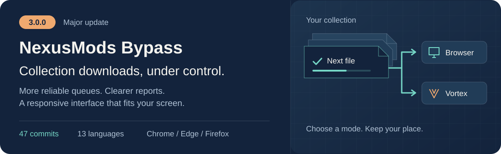

Download Nexus Mods collections to your browser or Vortex. Choose your files, control the pace and pick up where you left off.

  

<a href="#install">Install</a> &nbsp; / &nbsp; <a href="#features">Features</a> &nbsp; / &nbsp; <a href="#help">Help &amp; bugs</a> &nbsp; / &nbsp; <a href="#privacy">Privacy</a> &nbsp; / &nbsp; <a href="#source">For contributors</a>

**3.0.0 is available on GitHub.** Store versions may differ from the GitHub release.
Read the [major-update notes](https://github.com/thomasthanos/nexusmods-bypass/releases/tag/3.0.0)
or [browse the full changelog](CHANGELOG.md).

> [!WARNING]
> Use at your own risk. Skipping the download countdown through the ad-timer cookie
> and requesting download links through the background collection queue may conflict
> with the Nexus Mods Terms of Service. Nexus Mods could restrict accounts that use
> these features. Consider supporting Nexus Mods and mod authors with Premium.
> This extension does not unlock Premium-only content.

## Get started

Choose a store button above for a permanent installation, or use the GitHub packages:

| Your browser | GitHub 3.0.0 package |
| :--- | :--- |
| Chrome, Edge, Brave or Opera | [Download browser ZIP](https://github.com/thomasthanos/nexusmods-bypass/releases/download/3.0.0/nexus.mods.bypass-3.0.0.zip) |
| Firefox 140+ | [Download Firefox ZIP](https://github.com/thomasthanos/nexusmods-bypass/releases/download/3.0.0/nexus.mods.bypass-3.0.0-firefox.zip) |
| Check package integrity | [SHA-256 checksums](https://github.com/thomasthanos/nexusmods-bypass/releases/download/3.0.0/SHA256SUMS-3.0.0.txt) |

<strong>Install a GitHub package — Chrome, Edge, Brave or Opera</strong>

1. Download the browser ZIP and extract it into a new folder.
2. Open your browser's extensions page, such as `chrome://extensions` or `edge://extensions`.
3. Turn on **Developer mode**.
4. Select **Load unpacked** and choose the extracted folder.

When updating an existing unpacked installation, keep using the same extension entry
and folder to retain its identity. A separate installation may use separate local storage.

<strong>Install a GitHub package — Firefox</strong>

1. Download the Firefox ZIP. Firefox **140 or newer** is required.
2. Open `about:debugging#/runtime/this-firefox`.
3. Select **Load Temporary Add-on** and choose the ZIP directly.

The temporary add-on is removed when Firefox closes. Use the official Firefox
Add-ons listing for a permanent, signed installation.

**Then open Nexus Mods and sign in.** On a mod's **Files** tab, use **Mod manager download**
or **Manual download** as usual. On a collection page, select the files and download mode
from the extension's collection panel.

> **Using Vortex?** Keep Vortex running. The extension can confirm that it handed off
> a link; it cannot confirm that Vortex finished downloading the file.

## What it helps with

| Use it for | What you get |
| :--- | :--- |
| **Individual downloads** | Automatic starts, optional requirement-screen skipping and restored download buttons for archived files. |
| **Collection queues** | Browser or Vortex mode, file selection, smallest-files-first ordering, pacing and a confirmation before runs of more than 50 mods. |
| **Resume & recovery** | Local history, skip-downloaded controls, backoff for recoverable failures and a list of skipped files with their reasons. |
| **Collection updates** | Revision/update badges, optional curator update policies and click-only Endorse/Track controls. |
| **Wabbajack import · beta** | Import a `.wabbajack` file or a ZIP containing one; identify local archives by MD5 without uploading the archives. Extract RAR/7z files first. |
| **Reports & debugging** | An editable report workspace, a reviewed/redacted JSON snapshot, GitHub fallback and an opt-in live debug log. |

The interface supports **13 languages**, an **Always use English** switch and responsive
panels designed for 720p through 4K, with keyboard-friendly controls and reduced-motion support.

<strong>What's different in 3.0.0?</strong>

- **Download reliability:** one owner per click, duplicate-start protection and file-pinned
  requirements modals. Removed or missing mods are skipped rather than retried indefinitely.
- **Official Nexus API:** collection, revision, game and file details with caching, throttling,
  rate-limit handling and an outage fallback.
- **Modern reporting:** problem categories, summary, reproduction steps, expected results and
  the same reviewed snapshot for send, copy and save.
- **Live debug page:** minimum-level filter, search, follow mode, clear and text/JSON export.
- **Clearer delivery:** report health checks and specific errors; severity-coloured Discord
  reports, full JSON attachments and deduplication of repeated automatic errors.
- **UI polish:** responsive layouts, corrected popup width, themed scrollbars and accessible
  dropdowns across all 13 languages.

This is a cumulative milestone, including work previously shipped in the 2.x line.
The [release notes](internal/docs/releases/3.0.0.md) include all 47 commits in the requested update range.

## Make it work your way

Open the extension popup and choose **Page settings**. Changes save as you make them.
**Restore Defaults** resets the saved configuration and refreshes the Nexus page.

<strong>Download, collection and language settings</strong>

| Setting group | Controls |
| :--- | :--- |
| Download flow | Automatic starts, requirement screens, closing Vortex tabs, error popups and archived-file buttons. |
| Collection pacing | Smallest files first, pause between mods, browser download folder and Nexus download speed. |
| Nexus integration | Official API lookups (on by default), curator update policy (off by default) and Endorse/Track buttons. |
| Page appearance | Optional hiding of ads and Premium panels. |
| Advanced | Request timeout, Cloudflare fallback and close-tab delay. |
| Language | Always use English or the browser's supported language. |

Following curator policies only changes files where the collection allows updates.
Exact-version pins remain pinned. See the [Nexus integration notes](docs/nexus-site-map.md).

## Help & bugs

**Send a report:** popup → **Help & Bugs → Send bug report**.
Describe the problem, add reproduction steps and review the diagnostic snapshot.
You can send through the optional relay, copy/save the JSON or open a prefilled GitHub issue.

**Inspect the log:** popup → **Help & Bugs → Debug log**.
Logging is opt-in; the page lets you turn it on, filter by level, search and export.
Automatic error reporting is separate and **off by default**.

<strong>Common fixes</strong>

| Problem | Try this |
| :--- | :--- |
| Downloads do not start | Sign in to Nexus Mods and enable **Start downloads automatically** in Page settings. |
| Vortex does not receive a file | Start Vortex first; increase **Close-tab delay** if it needs more time to pick up the link. |
| A collection pauses at a rate limit | Leave the collection tab open; the queue can resume after the wait. |
| Cloudflare keeps asking for verification | Complete the check in a normal Nexus tab. If it keeps returning, try disabling your VPN or proxy. |
| Previously downloaded files start again | Choose **Skip Downloaded**. Clearing local history removes the extension's record of completed downloads. |
| A report cannot be sent | Check the specific failure message; use retry where offered, or save the JSON and use the GitHub fallback. |

While a collection is running, keeping **Hide ads and Premium panels** enabled refreshes
the site's download ad-timer cookie. That option is subject to the risk warning above.

[Open an issue](https://github.com/thomasthanos/nexusmods-bypass/issues/new)
if the built-in report flow is unavailable. Include your extension version, browser and
steps to reproduce; avoid posting cookies, signed download links or credentials.

## Privacy, without surprises

Settings, download history and diagnostic logs stay in your browser's local extension
storage. There are **no analytics or extension accounts**. Downloads and collection
lookups contact Nexus Mods.

Reports are sent only when you choose to send one, or when you explicitly enable automatic
error reports. Diagnostic snapshots redact usernames, cookies, tokens, local paths and URL
queries. An optional reply e-mail is included only if you provide one in a manual report.

<strong>Permissions and optional reporting</strong>

| Permission | Why it is needed |
| :--- | :--- |
| `storage` | Local settings, download history and diagnostic logs. |
| `downloads` | Start and track browser downloads. |
| `scripting` | Add the extension's own packaged controls to Nexus pages when needed. |
| `alarms` | Pace the background collection queue. |
| `https://www.nexusmods.com/*` | Operate on Nexus pages and resolve downloads. |
| `https://nexusmods-bypass-relay.mariosthanos3.workers.dev/*` — optional | Deliver a report to the maintainer. Requested when sending a report or enabling automatic reports. |

No `tabs` permission, all-URLs access or remote executable code. The optional
[Cloudflare relay](relay/README.md) forwards reports to a private Discord channel.
Secrets are kept in the relay, never in the extension package.

Automatic reports remain off until enabled. Revoking relay access or disabling the setting
stops them. For archive identification, MD5 is calculated locally; only the hash is sent
to the Nexus lookup service.

[Read the privacy policy](PRIVACY.md).

## For contributors

The extension has no runtime package dependencies. Development tooling requires
**Node.js 20+**; the manifest is the source of truth for the extension version.

<strong>Find your way around the source</strong>

| Area | Start here |
| :--- | :--- |
| Background queue & browser downloads | [src/background.js](src/background.js) |
| Nexus page controls & download flow | [src/content/](src/content/) |
| Shared defaults, URL parsing & diagnostics | [src/shared.js](src/shared.js), [src/download-url-parser.js](src/download-url-parser.js), [src/report.js](src/report.js) |
| Popup & guided setup | [src/popup/](src/popup/), [src/onboarding/](src/onboarding/) |
| Report workspace & live log | [src/report-page/](src/report-page/), [src/debug-page/](src/debug-page/) |
| Translations | [src/_locales/](src/_locales/) |
| Regression fixtures, packaging & browser checks | [tools/](tools/), [tests/visual/](tests/visual/) |
| Optional report relay | [relay/](relay/) |

Translation changes can be checked with `node tools/check-locales.mjs`.
`npm run build` runs regression checks and packages Chrome/Edge and Firefox ZIPs.
The release gate also runs lint and browser-layout checks.

## Licence & attribution

Most code is **source-available**, not open source, under the repository [licence](LICENSE).
The *NexusMods Bypass* name, `src/icons/` and `internal/` are excluded from its permissions.

[src/content/nnw.js](src/content/nnw.js) is separately licensed
[GPL-3.0-or-later](src/LICENSE-GPL-3.0-or-later.txt), based on
[Nexus No Wait ++](https://github.com/torkelicious/nexus-no-wait-pp).
Other original code, including the download URL parser, remains under the main licence.
See the [third-party notices](THIRD-PARTY-NOTICES.md).

**Not affiliated with, endorsed by or connected to Nexus Mods.**

---

[Releases](https://github.com/thomasthanos/nexusmods-bypass/releases) · [Changelog](CHANGELOG.md) · [Privacy](PRIVACY.md) · [Issues](https://github.com/thomasthanos/nexusmods-bypass/issues)
