  

  
  
  
  
  

NexusMods Bypass is a plain JavaScript browser extension. It contains no framework, bundled third-party runtime, remotely loaded code, advertising SDK, or analytics SDK.

## Nexus No Wait ++

[`src/content/nnw.js`](src/content/nnw.js) is based on **Nexus No Wait ++** by Torkelicious and
upstream contributors:

- Upstream repository: [torkelicious/nexus-no-wait-pp](https://github.com/torkelicious/nexus-no-wait-pp)
- Published userscript: [Nexus No Wait ++ on Greasy Fork](https://greasyfork.org/scripts/519037-nexus-no-wait)
- Licence: [GNU GPL version 3 or later](src/LICENSE-GPL-3.0-or-later.txt)

Thomas Thanos maintains the extension adaptation and its subsequent modifications. The Nexus No
Wait ++ maintainer has confirmed that `nnw.js` may be distributed as part of NexusMods Bypass under
GPL-3.0-or-later with this attribution, while the remaining original extension code retains its
current licence. The repository's main [licence](LICENSE) documents that scope.

Reading download links out of Nexus Mods responses is handled by
[`src/download-url-parser.js`](src/download-url-parser.js), which both `nnw.js` and the background
worker call. That file is original NexusMods Bypass code under the main licence; `nnw.js` no longer
contains a parser of its own.

## Nexus Mods and Vortex

The extension operates on Nexus Mods pages and can hand download links to Vortex. *Nexus Mods*, *Vortex*, their logos, product names, site content, and trademarks belong to their respective owners.

NexusMods Bypass is not affiliated with, endorsed by, sponsored by, or connected to Nexus Mods.

- [Nexus Mods terms of service](https://help.nexusmods.com/article/18-terms-of-service)
- [Nexus Mods privacy policy](https://help.nexusmods.com/article/20-privacy-policy)

## Browser platforms

Chrome, Chromium, Edge, and Firefox APIs and trademarks belong to their respective owners. Compatibility with a browser does not imply endorsement.

If a notice appears incomplete, open an issue in the [repository](https://github.com/thomasthanos/nexusmods-bypass/issues).

  

